# 🖥️ My_OS — Un système d'exploitation assisté par IA, local et sécurisé

🇬🇧 **[Read in English](README.md)**

[](https://github.com/gonicolas12/My_OS/releases/latest)
[](LICENSE)


-222)


**Local-first · Sécurisé par conception · Open source (MIT) · Français et anglais**

> Une distribution Linux (base Arch) dans laquelle une IA est intégrée *au cœur du
> système*. Un raccourci clavier global ouvre un assistant qui peut lire et organiser
> vos fichiers, installer des logiciels, ajuster les paramètres de la machine et
> piloter votre PC en langage naturel, en français ou en anglais — avec une
> **confirmation systématique** pour toute action à risque. Le modèle tourne
> **localement** (Qwen via Ollama) ; un modèle cloud (Claude) peut être activé **en
> option, par requête**. Vos données restent chez vous par défaut.

My_OS est la suite logique de [My_AI](https://github.com/gonicolas12/My_AI) : on passe
d'une *application* qui parle au PC à un *système* dans lequel l'IA est résidente et
profondément intégrée.

> **État du projet : v1.6 publiée ([télécharger](https://github.com/gonicolas12/My_OS/releases/tag/v1.6)), validée en VM ; nouveauté : My_OS parle français et anglais — interface, assistant (local et cloud) et contrôle de l'ordinateur ; il suit la langue de Linux au premier lancement, et le bouton 🌐 change de langue à tout moment. Elle garde tout de la v1.5, dont le contrôle de l'ordinateur : le modèle local voit l'écran et agit à la souris et au clavier, avec des bords lumineux et une barre d'arrêt (session X11).** Les cinq jalons (socle →
> fichiers/permissions → pilotage système → routeur cloud → packaging) sont terminés, et
> l'ISO a été testée de bout en bout en VM (BIOS et UEFI) en octobre 2026 : permissions,
> confirmations, élévation polkit, réglages, modèle local, contrôle de l'ordinateur, les
> deux langues ([détails](docs/SECURITY.md#8--validation-en-vm-octobre-2026)). **X11 est
> pleinement supporté ; le port Wayland est expérimental** (cf. [§7](#7--sécurité) et
> [docs/INSTALLATION.md](docs/INSTALLATION.md)).

---

## 📸 Aperçu

Captures réelles de My_OS en VM (modèle local Qwen 3.5 4B, octobre 2026).

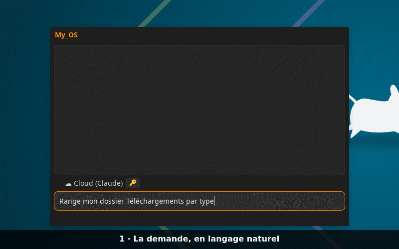

*« Range mon dossier Téléchargements par type » : le modèle liste le dossier puis propose
chaque déplacement ; une seule confirmation « Pour cette session » suffit, il range tout
(chaque action dans sa carte) et fait son compte rendu. Les temps d'attente sont
raccourcis : avec la carte graphique intégrée du PC de test, la demande a pris un peu
plus d'une minute.*

| | |
|:---:|:---:|
| 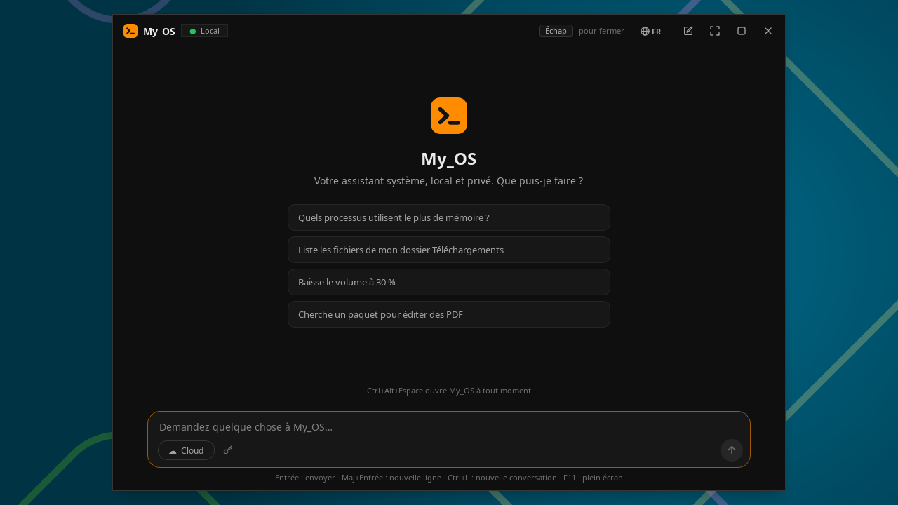 | 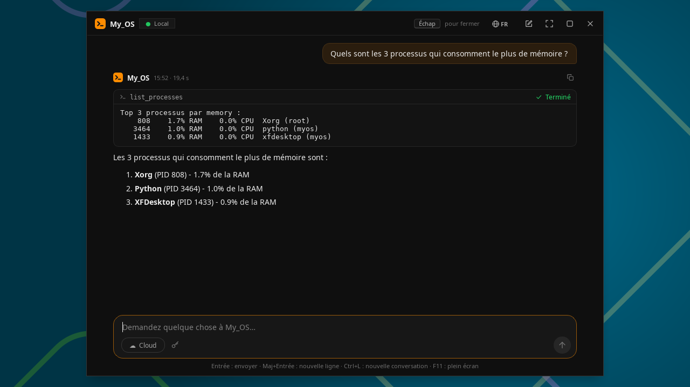 |
| **Popup au raccourci** — suggestions, rappel « Échap pour fermer », bouton de langue 🌐 ; fenêtre redimensionnable, agrandie ou en plein écran (`F11`) | **Réponse du modèle local** — le résultat de l'outil dans sa carte, puis la réponse ; « ☁ Cloud » active Claude à la demande |
| 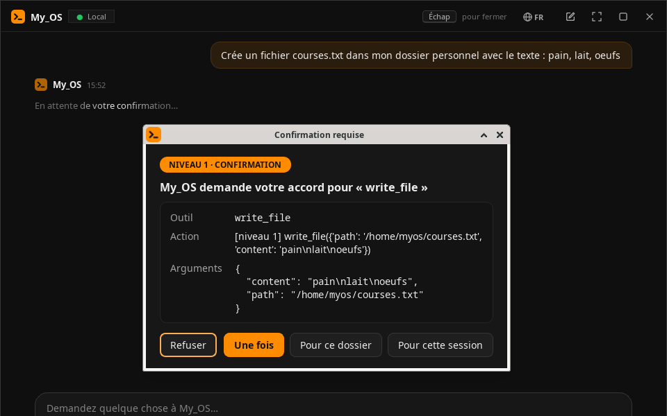 | 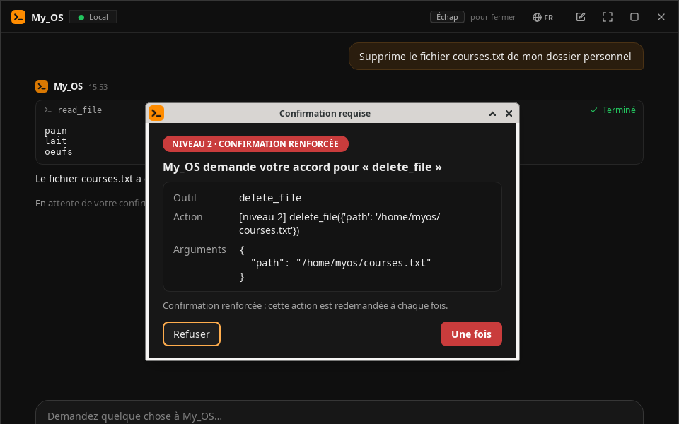 |
| **Confirmation (niveau 1)** — écriture proposée par le modèle : une fois, ce dossier ou la session | **Confirmation renforcée (niveau 2)** — suppression : « une fois » seulement, « Refuser » par défaut |
| 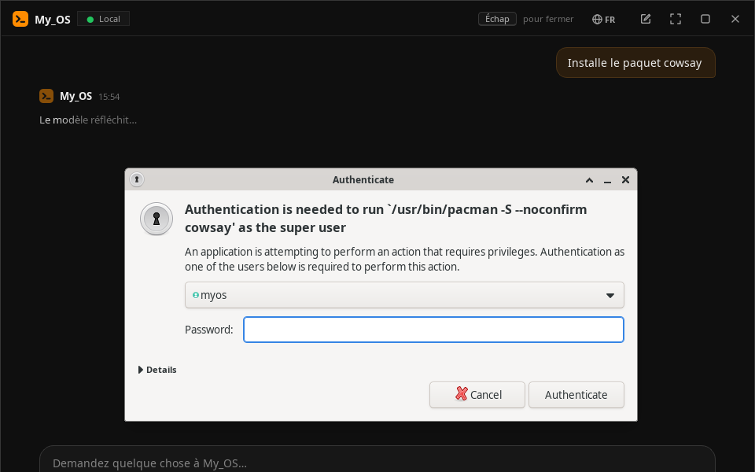 | 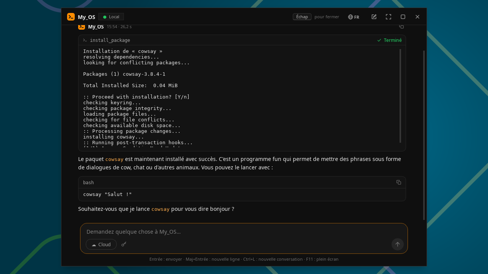 |
| **Élévation polkit** — mot de passe pour la commande exacte, jamais de root permanent | **Installation terminée** — chaque outil dans sa carte (statut, sortie de `pacman` lisible), puis le compte rendu du modèle |

### 🖱️ Contrôle de l'ordinateur *(v1.5)*

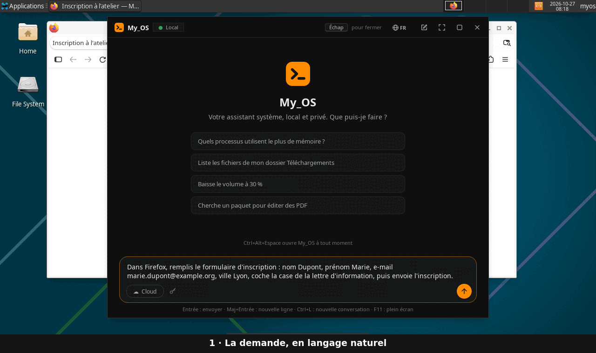

*« Dans Firefox, remplis le formulaire d'inscription : nom Dupont, prénom Marie, e-mail
marie.dupont@example.org, ville Lyon, coche la case de la lettre d'information, puis
envoie l'inscription. » Après l'accord pour cette demande, les bords de l'écran
s'illuminent en orange et le modèle local agit seul : il lit l'écran (éléments
numérotés), remplit les champs, choisit la ville et coche la case ; l'envoi, action
sensible, redemande une confirmation renforcée. Échap ou ■ arrête tout, à tout moment.
Les temps d'attente sont raccourcis : avec la carte graphique intégrée du PC de test, la
demande a pris un peu plus de trois minutes. Firefox, absent de l'ISO, a été installé
pour la démo.*

| | |
|:---:|:---:|
| 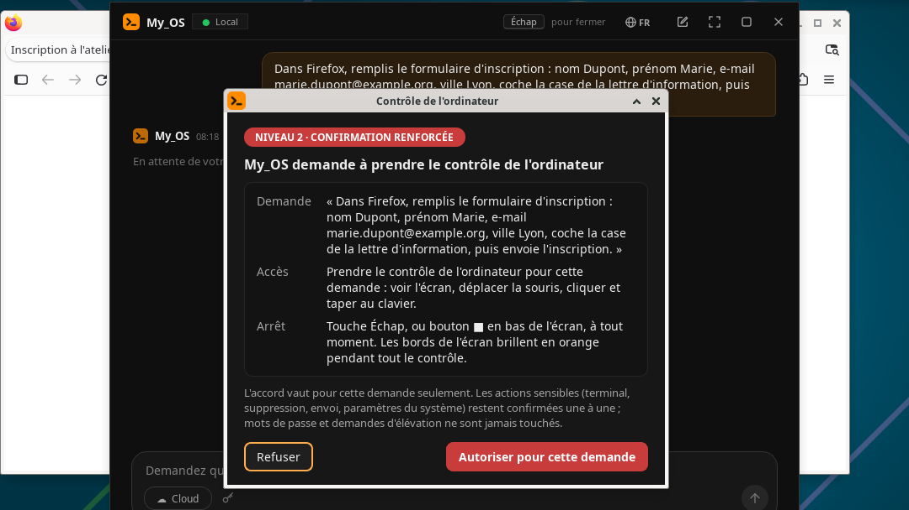 | 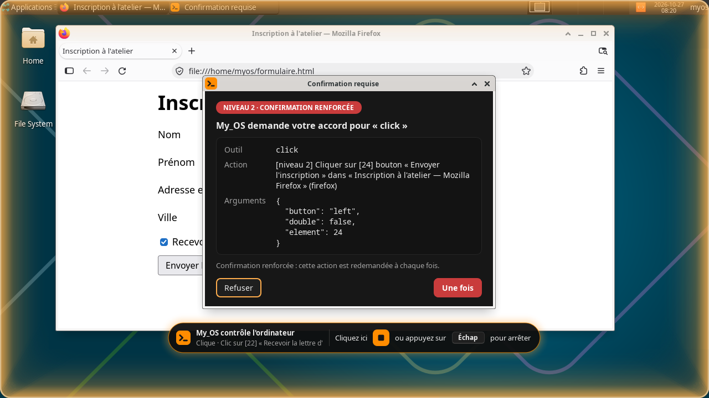 |
| **Accord pour cette demande** — la demande telle que tapée, l'accès donné et comment arrêter ; « Refuser » par défaut | **Pendant le contrôle** — bords lumineux, barre d'arrêt (■ ou Échap) ; « Envoyer » redemande une confirmation renforcée, au-dessus de la barre |

### 🌐 Français et anglais *(v1.6)*

| | |
|:---:|:---:|
| 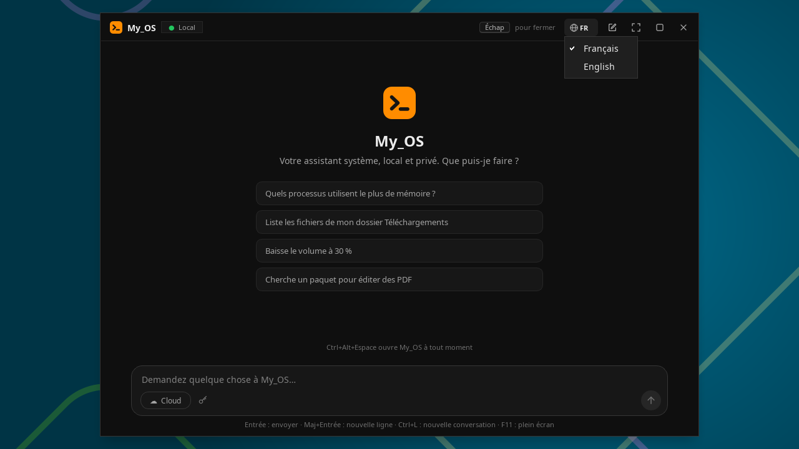 | 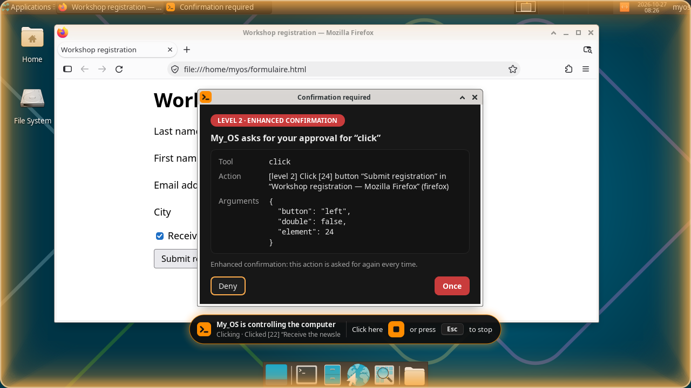 |
| **Langue au choix** — au premier lancement, celle de Linux (français, sinon anglais) ; le bouton 🌐 de la barre de titre passe de l'une à l'autre, sans redémarrer | **Tout suit la langue** — réponses du modèle, confirmations, barre d'arrêt : ici le même formulaire en anglais, « Submit » (envoyer) redemandant une confirmation |

---

## 📑 Sommaire

1. [Vision](#1--vision)
2. [Concept en une image](#2--concept-en-une-image)
3. [Fonctionnalités](#3--fonctionnalités)
4. [Installation](#4--installation)
5. [Utilisation](#5--utilisation)
6. [Le moteur de permissions](#6--le-moteur-de-permissions)
7. [Sécurité](#7--sécurité)
8. [Architecture](#8--architecture)
9. [Roadmap](#9--roadmap)
10. [Arborescence du projet](#10--arborescence-du-projet)
11. [Développement](#11--développement)
12. [Contribuer](#12--contribuer)
13. [Licence](#13--licence) · [Crédits](#14--crédits)

---

## 1 · Vision

My_OS répond à une idée simple : et si l'assistant IA n'était pas une application qu'on
ouvre, mais une **capacité du système** lui-même, disponible partout et tout le temps
via un raccourci clavier ?

- **Local par défaut** — le modèle Qwen tourne sur la machine via Ollama. Aucune donnée
  ne sort sans action explicite.
- **Cloud en option** — avec une clé API, on peut router une requête vers un modèle plus
  puissant (Claude). Opt-in, **par requête**, visible et journalisé.
- **Accès réel au système** — fichiers, paquets, paramètres, processus, et l'écran
  lui-même (souris, clavier). L'IA agit, elle ne fait pas que répondre.
- **Sûr par conception** — chaque action est classée par risque ; les actions sensibles
  demandent confirmation ; tout est journalisé ; rien de destructeur n'est silencieux.
- **Dans votre langue** — français ou anglais, celle de votre Linux par défaut.

**Objectifs du projet** : portfolio technique, projet d'école (Ynov), et base open
source réutilisable.

---

## 2 · Concept en une image

```
                    ┌─────────────────────────────┐
   Raccourci  ───>  │   Popup My_OS (Qt/PySide6)  │
   clavier global   │   « Tapez votre message… »  │
                    └──────────────┬──────────────┘
                                   │  IPC (socket Unix)
                    ┌──────────────▼──────────────┐
                    │      Daemon myosd           │
                    │   (orchestrateur résident)  │
                    └──────────────┬──────────────┘
                                   │
              ┌────────────────────┼────────────────────┐
              ▼                    ▼                    ▼
      ┌───────────────┐   ┌────────────────┐   ┌─────────────────┐
      │ Modèle local  │   │ Moteur de      │   │ Routeur cloud   │
      │ Qwen/Ollama   │   │ permissions    │   │ Claude (opt-in) │
      │ (défaut)      │   │ + audit        │   │                 │
      └───────────────┘   └───────┬────────┘   └─────────────────┘
                                  │ valide chaque action
                          ┌───────▼────────┐
                          │  Outils        │
                          │ fichiers,      │
                          │ paquets, D-Bus,│
                          │ processus,     │
                          │ écran          │
                          └────────────────┘
```

---

## 3 · Fonctionnalités

Toutes ces capacités sont **opérationnelles** (v1, contrôle de l'ordinateur depuis la
v1.5, français et anglais depuis la v1.6) et passent par le moteur de permissions.

- 🗂️ **Fichiers** — lire, lister, écrire, déplacer, créer, supprimer. Ex. « range mon
  dossier Téléchargements par type ». L'escalade de risque détecte les chemins sensibles
  (`~/.ssh`, `/etc`…), y compris derrière un lien symbolique ou un chemin relatif.
- 📦 **Paquets** (`pacman`) — rechercher, installer, supprimer, mettre à jour. Élévation
  ponctuelle via polkit (`pkexec`), jamais root en permanence. Fonctionne aussi depuis
  l'ISO live (paquets figés sur un instantané de l'Arch Linux Archive).
- 🔧 **Réglages système** (D-Bus / `pactl`) — luminosité, volume, sourdine, Wi-Fi.
- 📊 **Processus** (`psutil`) — lister les processus, en tuer un (avec garde-fous :
  PID critiques bloqués).
- 🧠 **Modèle local** — Qwen via Ollama, par défaut, **100 % sur la machine**.
- ☁️ **Cloud opt-in** — Claude (API Anthropic), activé **par requête** via un toggle
  visible ; clé API dans le trousseau du système (`keyring`), jamais en clair.
- 🛡️ **Permissions & audit** — 4 niveaux de risque, confirmations (« Refuser » par
  défaut), blocklist infranchissable, journal SQLite de chaque action.
- ⌨️ **Raccourci global** — X11 (`pynput`, nominal) et Wayland (portal
  `GlobalShortcuts`, **expérimental**).
- 💬 **Popup instantané** — PySide6 + `QTextBrowser` (aucun moteur web), réponses en
  streaming rendues en markdown, sorties d'outils dans des cartes, thème noir et orange.
  Fenêtre redimensionnable par les bords, agrandissable, en plein écran (`F11`), qui
  revient là où on l'a laissée.
- 🖱️ **Contrôle de l'ordinateur** *(v1.5)* — quand une demande passe par une
  application graphique, l'IA **voit l'écran** et agit : cliquer, taper, remplir des
  champs, combinaisons de touches, ouvrir une application, changer de fenêtre. **En
  local**, sans modèle de vision : l'écran lui est décrit par l'arbre d'accessibilité et
  l'OCR, chaque élément numéroté. Pendant le contrôle, les **bords de l'écran brillent en
  orange** et une barre rappelle comment l'arrêter (**Échap** ou bouton ■).
- 🌐 **Français et anglais** *(v1.6)* — interface, réponses du modèle (local ou cloud)
  et contrôle de l'ordinateur dans l'une ou l'autre langue. Au premier lancement, My_OS
  prend celle de Linux : français si le système est en français, anglais sinon. Le
  bouton 🌐 de la barre de titre change de langue à tout moment.

---

## 4 · Installation

Deux voies. Détails complets dans **[docs/INSTALLATION.md](docs/INSTALLATION.md)**.

### a) Via l'ISO live (le plus simple)

Une ISO bootable (base Arch + Xfce/X11) embarque My_OS prêt à l'emploi :
**[télécharger l'ISO de la v1.6](https://github.com/gonicolas12/My_OS/releases/tag/v1.6)**
(avec son fichier `.sha256`). Pour la construire vous-même, le profil
[archiso](https://wiki.archlinux.org/title/Archiso) et le script de build sont dans
[`packaging/`](packaging/) (`sudo ./packaging/build_iso.sh`, sur un hôte Arch). Au 1er
boot, les dépendances et le modèle local sont récupérés (réseau requis). Prévoir
**≥ 12 Go de RAM pour le modèle local en live** (≥ 4 Go sinon). Le modèle utilise une
carte graphique dédiée AMD, Intel ou NVIDIA récente via Vulkan si elle est présente,
sinon le processeur. Sur une clé USB : [Ventoy](https://www.ventoy.net) ou Rufus en
mode DD, Secure Boot désactivé ([détails](docs/INSTALLATION.md)). Voir aussi
[packaging/README.md](packaging/README.md). La session live est en anglais ; un clic
sur 🌐 passe My_OS en français.

### b) Depuis les sources

> Prérequis : Arch Linux (ou dérivé), Python 3.10+, [Ollama](https://ollama.com/download)
> et les paquets système listés dans [docs/INSTALLATION.md §2.1](docs/INSTALLATION.md)
> (dont `python-evdev`, nécessaire à `pynput`).

```bash
git clone https://github.com/gonicolas12/My_OS && cd My_OS
pip install -r requirements.txt
ollama pull qwen3.5:4b          # modèle local recommandé (≥ 8 Go RAM)
./launch_dev.sh                 # lance daemon + popup (session X11)
```

Sans GPU, une réponse du modèle 4B prend de quelques secondes à plus d'une minute selon
la machine. Avec une carte graphique, installez le backend d'Ollama qui lui correspond
(`ollama-cuda`, `ollama-rocm` ou `ollama-vulkan`, cf.
[docs/INSTALLATION.md §2.3](docs/INSTALLATION.md)).

Pour une installation **résidente** (service `systemd` utilisateur, autostart), suivre
[docs/INSTALLATION.md](docs/INSTALLATION.md). **Notes X11/Wayland** : X11 fonctionne tel
quel ; Wayland nécessite un compositeur avec `layer-shell` + portal `GlobalShortcuts` et
reste expérimental.

---

## 5 · Utilisation

1. Appuyez sur **Ctrl+Alt+Espace** (raccourci par défaut, modifiable dans `config.yaml`).
2. Le popup s'ouvre au-dessus de tout (centré la première fois, puis là où vous l'avez
   laissé). Tapez votre demande en langage naturel : `Entrée` envoie, `Maj+Entrée` va à
   la ligne.
3. Pour une action sensible, une **confirmation** détaillée apparaît au premier plan.
   Au niveau 1, vous pouvez autoriser *une fois*, *pour ce dossier* ou *pour la session* ;
   au niveau 2 (suppression, mise à jour…), seulement *une fois*, et la question revient
   à chaque action. **Entrée et Échap refusent** : approuver est toujours un choix
   explicite. Le mot de passe (polkit) n'est demandé que pour `pacman`.
4. `Échap` referme le popup (rappelé en haut à droite) ; `Ctrl+L` démarre une nouvelle
   conversation.
5. La fenêtre se redimensionne par ses bords et ses coins et se déplace par sa barre de
   titre ; double-cliquez sur la barre pour l'agrandir, `F11` pour le plein écran. Taille,
   position et état sont mémorisés (`~/.config/my_os/popup.conf`).
6. Le bouton **🌐 FR / EN** de la barre de titre change la langue de My_OS : interface,
   réponses du modèle et contrôle de l'ordinateur passent en français ou en anglais,
   aussitôt et sans redémarrer ; le choix est mémorisé. Avant tout choix, My_OS suit la
   langue de Linux (réglage `language` de `config.yaml`).

**Exemples de requêtes :**
- « Range mon dossier Téléchargements par type. »
- « Installe VLC. »
- « Baisse la luminosité à 30 %. »
- « Qu'est-ce qui mange ma RAM en ce moment ? »
- « Résume ce fichier. » *(le contenu lu reste une donnée, jamais une instruction)*
- En anglais : *“Install VLC.”*, *“Lower the volume to 30%.”*, *“Open Mousepad and write
  a shopping list.”*

**Contrôle de l'ordinateur (session X11) :** demandez par exemple « Ouvre Mousepad et
écris une liste de courses » ou « Remplis ce formulaire avec mon nom ». My_OS demande
d'abord votre accord **pour cette demande** (« Autoriser pour cette demande » ;
« Refuser » par défaut). Le popup s'efface, les bords de l'écran brillent en orange clair
et une barre, en bas, montre l'action en cours : **« Cliquez ici ■ ou appuyez sur Échap
pour arrêter »**. À la fin, la lueur s'éteint et le popup revient avec le compte rendu.
Les actions sensibles (taper dans un terminal, bouton « Supprimer » ou « Envoyer »,
paramètres du système) restent confirmées une à une ; mots de passe, demandes
d'élévation et écran verrouillé ne sont jamais touchés.

**Mode cloud (optionnel) :** activez « ☁ Cloud » sous la zone de saisie, puis saisissez
votre clé API Anthropic (stockée dans le trousseau) ; un indicateur signale que **cette**
requête part au cloud. Conseil : `Ctrl+L` avant, pour minimiser les données envoyées.

---

## 6 · Le moteur de permissions

C'est le composant le plus important du projet : il garantit que **la sûreté ne dépend
pas de la fiabilité du modèle**.

| Niveau | Nom | Exemples | Comportement |
|--------|-----|----------|--------------|
| **0** | Auto | lire un fichier, lister, monitorer | Exécuté sans confirmation |
| **1** | Confirmation | écrire/déplacer, installer un paquet | Dialogue simple |
| **2** | Renforcée | supprimer, `sudo`, modifier le système, `/etc` `/boot` | Confirmation explicite + détail |
| **3** | Bloqué | `rm -rf /`, formatage, zones critiques | **Jamais exécuté, même confirmé** |

- **Statique d'abord** : le niveau vient du code (`permissions/risk_levels.py`), jamais
  du LLM.
- **Escalade par arguments** : ne peut qu'**augmenter** le risque (ex. écrire dans `~/.ssh`).
- **Chemin réel** : liens symboliques, chemins relatifs, `..` et `//` sont résolus avant
  toute décision — un lien vers `~/.ssh` est traité comme `~/.ssh`.
- **Blocklist en premier** : le niveau 3 est vérifié avant tout et ne peut être contourné.
- **Mémorisation** : *ce dossier* / *cette session*, **au niveau 1 seulement** — une
  action de niveau 2 est redemandée à chaque fois.
- **Audit** : chaque action et décision est journalisée dans `~/.local/share/my_os/audit.db` (SQLite).
- **Écran** : le contrôle de l'ordinateur est accordé **pour une requête** (niveau 2),
  toujours visible et arrêtable d'un Échap ; la cible jugée est celle de l'écran, jamais
  celle que décrit le modèle ([SECURITY.md](docs/SECURITY.md), menace 5).
- **Langue** : elle ne change aucune décision. Mêmes niveaux et mêmes confirmations en
  français et en anglais ; à l'écran, les boutons sensibles sont reconnus dans les deux
  langues, quelle que soit celle de My_OS.

---

## 7 · Sécurité

La sécurité de My_OS repose sur l'**architecture**, pas sur des correctifs ajoutés après
coup. Trois invariants non négociables :

1. **Le LLM ne décide jamais de son niveau de permission** — c'est du code statique. La
   blocklist (niveau 3) est infranchissable.
2. **Tout contenu lu (fichier, web, écran, sortie de commande) est une donnée non
   fiable**, jamais une instruction — défense contre l'injection de prompt indirecte.
3. **Le daemon tourne en utilisateur, jamais root** — élévation ponctuelle via polkit ;
   IPC sur socket Unix locale ; secrets via `keyring`.

Le **cloud reste opt-in par requête** et le **modèle local par défaut** (privé). Sous
Wayland, le **confinement** de la surface (layer-shell) est un *plus* de sécurité.

➡️ Modèle de menaces complet : **[docs/SECURITY.md](docs/SECURITY.md)**.

---

## 8 · Architecture

Cinq couches, construites de bas en haut :

| Couche | Rôle |
|--------|------|
| **0 · Base Arch Linux** | kernel, drivers, paquets |
| **1 · Daemon `myosd`** | service résident, raccourci global, IPC, orchestration |
| **2 · Outils + permissions** | outils système + moteur de permissions + audit (choke point) |
| **3a · Modèle local** | Qwen via Ollama (défaut, privé) |
| **3b · Routeur cloud** | Claude via clé API (opt-in) |
| **4 · Popup Qt** | interface invoquée au raccourci |

Daemon et popup sont **deux processus** communiquant par socket Unix. Toute action passe
par le point de passage unique `permissions/policy_engine.py`.

➡️ Détails : **[docs/ARCHITECTURE.md](docs/ARCHITECTURE.md)** · contrats d'interface :
**[docs/INTERFACES.md](docs/INTERFACES.md)**.

---

## 9 · Roadmap

**v1 — terminée ✅** (détails et vision long terme : [docs/ROADMAP.md](docs/ROADMAP.md)).

- [x] **Jalon 1 — Socle** : daemon systemd utilisateur, raccourci global (X11), IPC socket
  Unix, popup Qt.
- [x] **Jalon 2 — Fichiers + permissions** : outils fichiers, moteur de permissions
  complet, audit SQLite, confirmations, boucle agentique, Ollama.
- [x] **Jalon 3 — Pilotage système** : paquets (`pacman`), réglages (D-Bus), processus
  (`psutil`), élévation polkit ponctuelle.
- [x] **Jalon 4 — Routeur cloud** : clé API via `keyring`, toggle opt-in par requête,
  indicateur visible, journalisation.
- [x] **Jalon 5 — Packaging** : port Wayland (expérimental), profil ISO `archiso`,
  finalisation de la documentation.
- [x] **Sécurité (transverse)** : daemon non-root, séparation données/instructions,
  `SECURITY.md` tenu à jour.
- [x] **Validation en VM** (octobre 2026) : 42 scénarios de permissions, interface,
  élévation polkit, modèle local ; 6 contournements trouvés, corrigés et re-testés.

- [x] **v1.0 publiée** : [release GitHub](https://github.com/gonicolas12/My_OS/releases/tag/v1.0)
  avec l'ISO et sa somme SHA-256.
- [x] **v1.1 publiée** : [release GitHub](https://github.com/gonicolas12/My_OS/releases/tag/v1.1),
  interface du popup repensée : fenêtre redimensionnable, agrandie ou en plein écran,
  rappel « Échap pour fermer », conversation sur le gabarit de My_AI en noir et orange,
  cartes d'outils lisibles.
- [x] **v1.2 publiée** : [release GitHub](https://github.com/gonicolas12/My_OS/releases/tag/v1.2),
  modèle local : conversations longues sans réponse coupée (fenêtre de 16 384 tokens),
  carte graphique via Vulkan, réponses plus rapides sans GPU, contexte en 8 bits, Ollama
  en local seul.
- [x] **v1.3 publiée** : [release GitHub](https://github.com/gonicolas12/My_OS/releases/tag/v1.3),
  correctif : la saisie de la clé API du mode cloud s'ouvre au-dessus du popup (elle
  s'ouvrait dessous et le bloquait sans être visible).
- [x] **v1.4 publiée** : [release GitHub](https://github.com/gonicolas12/My_OS/releases/tag/v1.4),
  correctif : le premier réglage du son après le démarrage (volume, sourdine) n'échoue
  plus pendant que le serveur son démarre.
- [x] **v1.5 publiée** : [release GitHub](https://github.com/gonicolas12/My_OS/releases/tag/v1.5),
  contrôle de l'ordinateur : voir l'écran et agir à la souris et au clavier, en local
  (accessibilité + OCR, éléments numérotés), bords lumineux et barre d'arrêt, accord par
  demande ; validé en VM avec le modèle local.
- [x] **v1.6 publiée** : [release GitHub](https://github.com/gonicolas12/My_OS/releases/tag/v1.6),
  français et anglais : interface, modèle local et cloud, contrôle de l'ordinateur ;
  langue de Linux au premier lancement, bouton 🌐 FR / EN ; validée en VM dans les deux
  langues (mêmes 42 scénarios de permissions, mêmes décisions).

**Encore à éprouver :** matériel réel (pilotes Wi-Fi, rétroéclairage, cartes graphiques)
et mode cloud avec une vraie clé — retours bienvenus dans les
[issues](https://github.com/gonicolas12/My_OS/issues).

**Au-delà (vision long terme, non promise) :** vision pure pour les applications sans
accessibilité ni texte (modèle local spécialisé, sur carte graphique), défenses
anti-injection avancées, Wayland natif grand public, d'autres langues. Voir
[docs/ROADMAP.md](docs/ROADMAP.md).

---

## 10 · Arborescence du projet

```
My_OS/
├── daemon/                   # Couche 1 — cœur résident
│   ├── myosd.py              # point d'entrée du service
│   ├── hotkey_listener.py    # raccourci global (X11 pynput / Wayland portal)
│   ├── ipc_server.py         # socket Unix daemon ↔ popup
│   ├── orchestrator.py       # boucle agentique requête → modèle → outils
│   ├── control.py            # session de contrôle de l'écran (indicateur, arrêt)
│   └── confirmation_provider.py
├── permissions/              # Couche 2 — sécurité (cœur)
│   ├── risk_levels.py        # table statique outil → niveau
│   ├── policy_engine.py      # décision + escalade (point de passage unique)
│   ├── blocklist.py          # niveau 3, jamais autorisé
│   ├── confirmation.py
│   ├── session_grants.py     # une fois / dossier / session
│   └── audit_log.py          # journal SQLite
├── tools/                    # outils système
│   ├── base_tool.py          # base + risk_level
│   ├── files.py              # fichiers
│   ├── packages.py           # pacman
│   ├── system_settings.py    # D-Bus / pactl
│   ├── processes.py          # psutil
│   └── computer/             # contrôle de l'ordinateur : écran (accessibilité, OCR),
│                             # souris et clavier (xdotool), applications
├── models/                   # Couche 3 — IA
│   ├── local_llm.py          # Qwen/Ollama (défaut)
│   ├── prompts.py            # prompts système, un par langue
│   ├── cloud_router.py       # routeur + API Anthropic (opt-in)
│   ├── secrets.py            # clé API via keyring
│   └── stub_model.py         # backend de règles (tests / sans Ollama)
├── ui/                       # Couche 4 — popup Qt
│   ├── popup.py              # fenêtre PySide6, client IPC, états de la fenêtre
│   ├── chat_view.py          # conversation : bulles, réponses, cartes d'outils
│   ├── composer.py           # zone de saisie (Cloud, clé API, envoi)
│   ├── window_chrome.py      # barre de titre (menu de langue 🌐) + redimensionnement
│   ├── markdown_render.py    # markdown sans HTML ni image (QTextBrowser)
│   ├── confirm_dialog.py     # dialogue de confirmation
│   ├── control_overlay.py    # bords lumineux + barre d'arrêt du contrôle
│   ├── icons.py              # icônes et logo dessinés (QPainter)
│   ├── styles.py             # jetons de design, thème noir/orange
│   └── wayland_layer.py      # présentation Wayland (layer-shell), repli X11
├── core/
│   ├── config.py             # config + résolution socket
│   ├── ipc.py                # cadrage des messages
│   ├── elevation.py          # exécution système + polkit (pkexec)
│   ├── session.py            # détection X11/Wayland
│   ├── i18n.py               # langue (français, anglais) : tr(), langue du système
│   ├── locales/en.py         # traductions anglaises (le français est dans le code)
│   └── logger.py
├── docs/
│   ├── ARCHITECTURE.md
│   ├── SECURITY.md           # modèle de menaces + validation en VM
│   ├── INTERFACES.md         # contrats d'interface
│   ├── INSTALLATION.md       # install (sources + ISO) + dépannage
│   ├── ROADMAP.md            # v1 + vision long terme
│   └── media/                # captures d'écran des README (en/ : README anglais)
├── packaging/                # ISO live (archiso)
│   ├── build_iso.sh
│   ├── README.md
│   └── archiso/              # profiledef, packages, airootfs
├── tests/                    # ~860 tests (permissions en priorité)
├── config.yaml
├── myosd.service             # service systemd utilisateur
├── requirements.txt
├── launch_dev.sh
├── pyproject.toml
├── README.md                 # version anglaise
└── README.fr.md              # ce fichier
```

---

## 11 · Développement

```bash
pip install -r requirements.txt
./launch_dev.sh                 # daemon + popup en dev (X11)

pytest                          # tous les tests
pytest tests/test_permissions/  # le cœur de sécurité (prioritaire)
ruff check . && ruff format .   # lint + format
```

Conventions : Python 3.10+, type hints partout, docstrings sur les fonctions publiques.
Tout nouvel outil hérite de `tools/base_tool.py` et **doit** déclarer un `risk_level`.
Aucune action ne contourne `permissions/policy_engine.py`. Aucun secret en clair. Tout
texte montré à l'utilisateur ou au modèle s'écrit en français et passe par `tr()`, avec
sa traduction dans `core/locales/en.py` (les tests échouent sinon).

---

## 12 · Contribuer

Les contributions sont bienvenues !

1. Forkez, créez une branche de feature (`git checkout -b ma-feature`).
2. Respectez les conventions ci-dessus et les contrats de [docs/INTERFACES.md](docs/INTERFACES.md).
3. **Couvrez le module `permissions/` en priorité** ; `ruff` propre, tests verts.
4. Pour la sécurité, lisez d'abord [docs/SECURITY.md](docs/SECURITY.md) — aucun changement
   ne doit affaiblir les trois invariants.
5. Ouvrez une Pull Request claire (un sujet = une PR).

Signalements de bugs et idées : via les *issues* GitHub, en français ou en anglais.

---

## 13 · Licence

[MIT](LICENSE). Vous êtes libre d'utiliser, modifier et redistribuer My_OS.

## 14 · Crédits

Conçu dans la lignée de [My_AI](https://github.com/gonicolas12/My_AI). Construit pour
rester **local, privé et sûr**. Merci aux projets qui le rendent possible : Arch Linux,
archiso, Ollama, PySide6/Qt, polkit, et l'écosystème Python.
