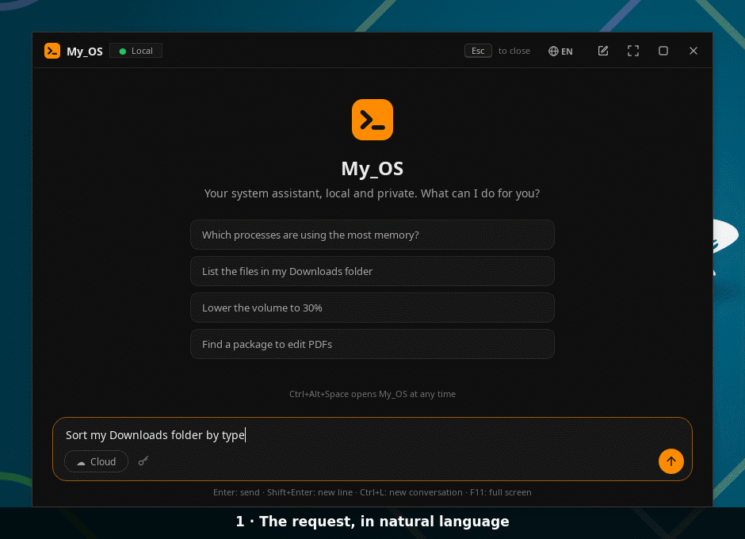
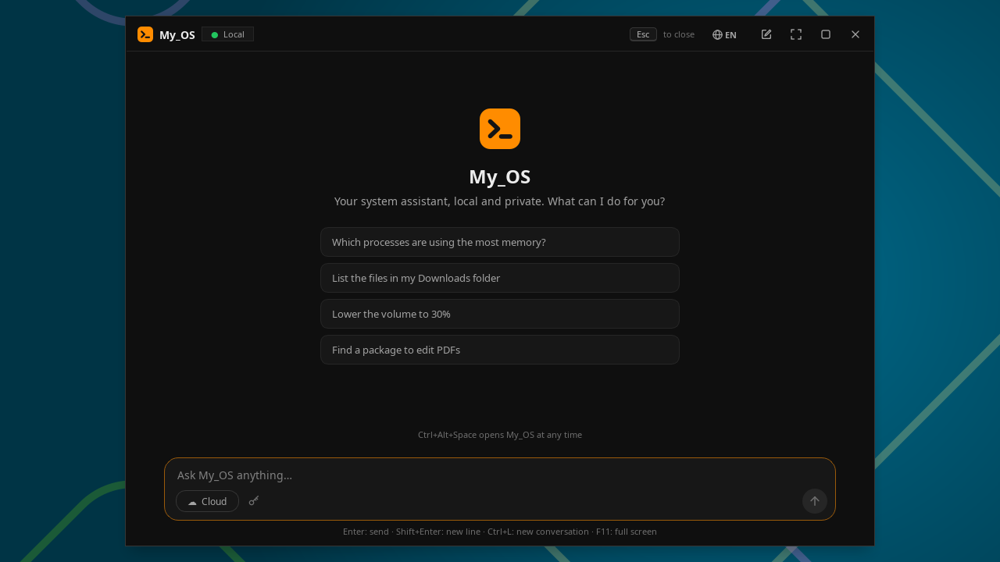
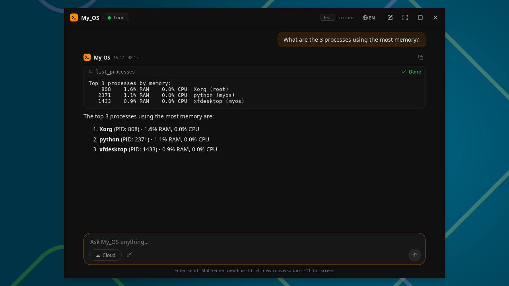
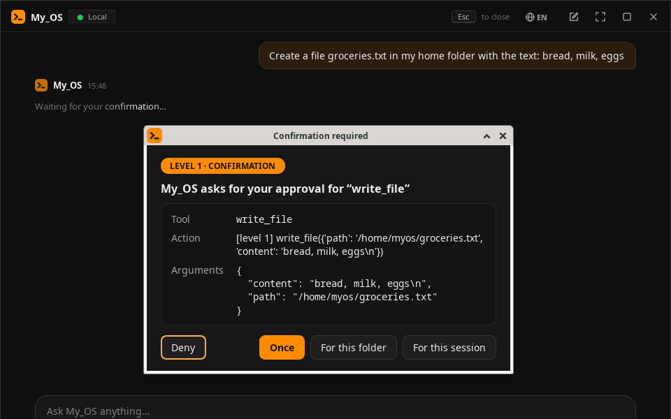
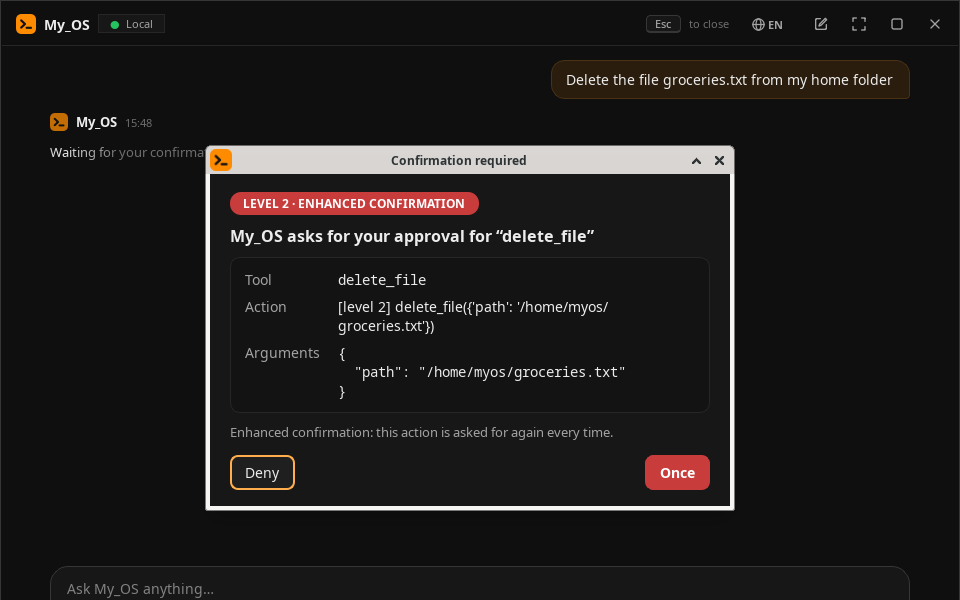
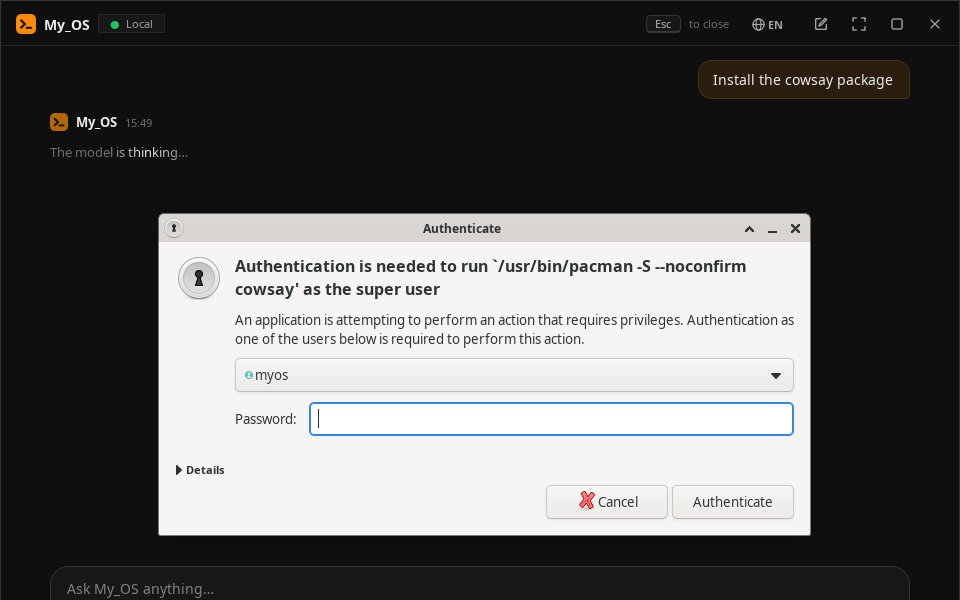
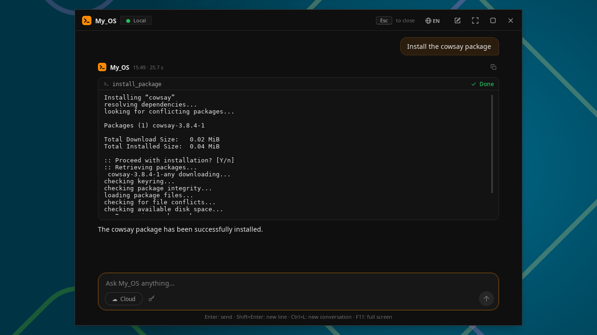
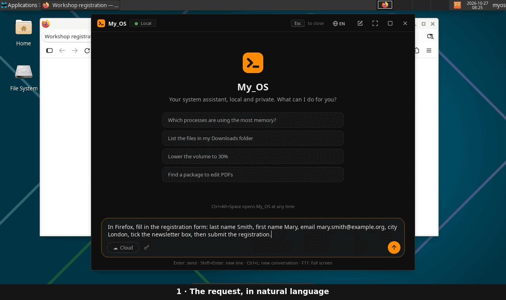
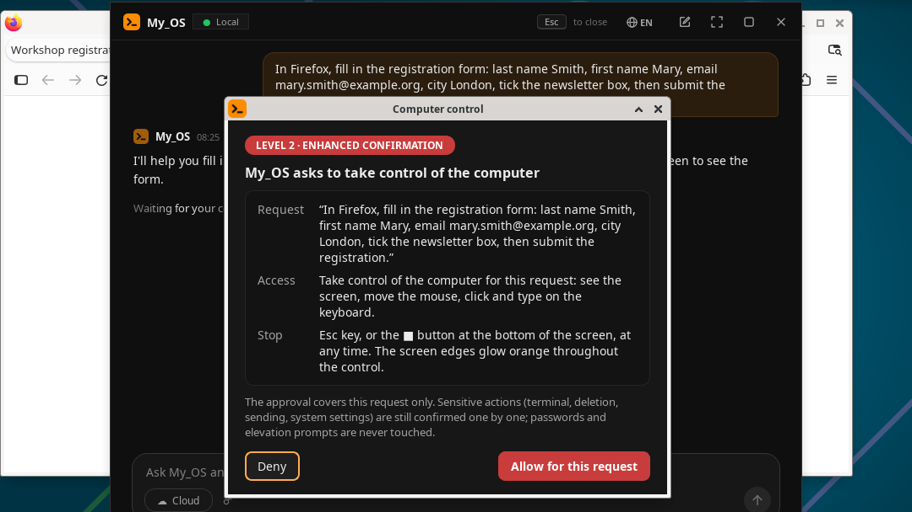
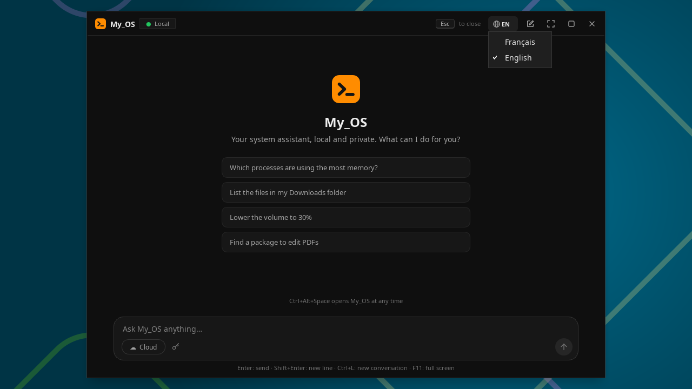

# 🖥️ My_OS — An AI-assisted operating system, local and secure

🇫🇷 **[Lire en français](README.fr.md)**

[](https://github.com/gonicolas12/My_OS/releases/latest)
[](LICENSE)


-222)


**Local-first · Secure by design · Open source (MIT) · English & French**

> A Linux distribution (Arch-based) with an AI built *into the core of the system*. A
> global keyboard shortcut opens an assistant that can read and organize your files,
> install software, adjust the machine's settings and drive your PC in natural
> language, in English or in French — with a **mandatory confirmation** for every risky
> action. The model runs **locally** (Qwen via Ollama); a cloud model (Claude) can be
> enabled **optionally, per request**. Your data stays with you by default.

My_OS is the follow-up to [My_AI](https://github.com/gonicolas12/My_AI): from an
*application* that talks to the PC to a *system* in which the AI is resident and deeply
integrated.

> **Project status: v1.6 released ([download](https://github.com/gonicolas12/My_OS/releases/tag/v1.6)), validated in a VM. New: My_OS speaks English and French — interface, assistant (local and cloud) and computer control; it follows your Linux language at first launch, and the 🌐 button switches at any time. It keeps everything from v1.5, including computer control: the local model sees the screen and acts with the mouse and keyboard, with glowing edges and a stop bar (X11 session).** The five milestones (foundation →
> files/permissions → system control → cloud router → packaging) are complete, and the
> ISO was tested end to end in a VM (BIOS and UEFI) in October 2026: permissions,
> confirmations, polkit elevation, settings, local model, computer control, both
> languages ([details](docs/SECURITY.md#8--validation-en-vm-octobre-2026)). **X11 is
> fully supported; the Wayland port is experimental** (see [§7](#7--security) and
> [docs/INSTALLATION.md](docs/INSTALLATION.md)).

> 📚 The detailed documentation in [`docs/`](docs/) is written in French.

---

## 📸 Preview

Real screenshots of My_OS in a VM (local model Qwen 3.5 4B, October 2026).



*“Sort my Downloads folder by type”: the model lists the folder, then proposes each
move; a single “For this session” confirmation is enough, it sorts everything (each
action in its card) and reports back. Waiting times are shortened: with the test PC's
integrated GPU, the whole request took about a minute.*

| | |
|:---:|:---:|
|  |  |
| **Popup on the shortcut** — suggestions, “Esc to close” hint, 🌐 language button; resizable window, maximized or full screen (`F11`) | **Local model answer** — the tool result in its card, then the answer; “☁ Cloud” enables Claude on demand |
|  |  |
| **Confirmation (level 1)** — a write proposed by the model: once, this folder or the session | **Enhanced confirmation (level 2)** — deletion: “once” only, “Deny” by default |
|  |  |
| **polkit elevation** — password for the exact command, never permanent root | **Installation complete** — each tool in its card (status, readable `pacman` output), then the model's report |

### 🖱️ Computer control *(v1.5)*



*“In Firefox, fill in the registration form: last name Smith, first name Mary, email
mary.smith@example.org, city London, tick the newsletter box, then submit the
registration.” After approval for this request, the screen edges glow orange and the
local model acts on its own: it reads the screen (numbered elements), fills in the
fields, picks the city and ticks the box; submitting, a sensitive action, asks for an
enhanced confirmation again. Esc or ■ stops everything, at any time. Waiting times are
shortened: with the test PC's integrated GPU, the request took about two and a half
minutes. Firefox, not on the ISO, was installed for the demo.*

| | |
|:---:|:---:|
|  |  |
| **Approval for this request** — the request as typed, the access given and how to stop; “Deny” by default | **During control** — glowing edges, stop bar (■ or Esc); “Submit” asks for an enhanced confirmation again, above the bar |

### 🌐 English and French *(v1.6)*

| | |
|:---:|:---:|
|  |  |
| **Your language** — at first launch, your Linux language (French, otherwise English); the 🌐 button in the title bar switches between them, without restarting | **Everything follows the language** — model answers, confirmations, stop bar: here the same form in French, « Envoyer » (send) asking for confirmation |

---

## 📑 Contents

1. [Vision](#1--vision)
2. [Concept at a glance](#2--concept-at-a-glance)
3. [Features](#3--features)
4. [Installation](#4--installation)
5. [Usage](#5--usage)
6. [The permission engine](#6--the-permission-engine)
7. [Security](#7--security)
8. [Architecture](#8--architecture)
9. [Roadmap](#9--roadmap)
10. [Project layout](#10--project-layout)
11. [Development](#11--development)
12. [Contributing](#12--contributing)
13. [License](#13--license) · [Credits](#14--credits)

---

## 1 · Vision

My_OS starts from a simple idea: what if the AI assistant were not an application you
open, but a **capability of the system** itself, available everywhere and at any time
through a keyboard shortcut?

- **Local by default** — the Qwen model runs on the machine via Ollama. No data leaves
  without an explicit action.
- **Optional cloud** — with an API key, a request can be routed to a more powerful model
  (Claude). Opt-in, **per request**, visible and logged.
- **Real system access** — files, packages, settings, processes, and the screen itself
  (mouse, keyboard). The AI acts, it doesn't just answer.
- **Safe by design** — every action is classified by risk; sensitive actions ask for
  confirmation; everything is logged; nothing destructive is silent.
- **In your language** — English or French, your Linux language by default.

**Project goals**: technical portfolio, school project (Ynov), and a reusable open
source base.

---

## 2 · Concept at a glance

```
                    ┌─────────────────────────────┐
   Global     ───>  │   My_OS popup (Qt/PySide6)  │
   shortcut         │   “Ask My_OS anything…”     │
                    └──────────────┬──────────────┘
                                   │  IPC (Unix socket)
                    ┌──────────────▼──────────────┐
                    │      myosd daemon           │
                    │   (resident orchestrator)   │
                    └──────────────┬──────────────┘
                                   │
              ┌────────────────────┼────────────────────┐
              ▼                    ▼                    ▼
      ┌───────────────┐   ┌────────────────┐   ┌─────────────────┐
      │ Local model   │   │ Permission     │   │ Cloud router    │
      │ Qwen/Ollama   │   │ engine         │   │ Claude (opt-in) │
      │ (default)     │   │ + audit        │   │                 │
      └───────────────┘   └───────┬────────┘   └─────────────────┘
                                  │ validates every action
                          ┌───────▼────────┐
                          │  Tools         │
                          │ files,         │
                          │ packages,      │
                          │ D-Bus,         │
                          │ processes,     │
                          │ screen         │
                          └────────────────┘
```

---

## 3 · Features

All these capabilities are **operational** (v1, computer control since v1.5, English and
French since v1.6) and go through the permission engine.

- 🗂️ **Files** — read, list, write, move, create, delete. E.g. “sort my Downloads folder
  by type”. Risk escalation detects sensitive paths (`~/.ssh`, `/etc`…), even behind a
  symbolic link or a relative path.
- 📦 **Packages** (`pacman`) — search, install, remove, update. One-off elevation through
  polkit (`pkexec`), never permanent root. Also works from the live ISO (packages frozen
  on an Arch Linux Archive snapshot).
- 🔧 **System settings** (D-Bus / `pactl`) — brightness, volume, mute, Wi-Fi.
- 📊 **Processes** (`psutil`) — list processes, kill one (with safeguards: critical PIDs
  blocked).
- 🧠 **Local model** — Qwen via Ollama, by default, **100% on the machine**.
- ☁️ **Opt-in cloud** — Claude (Anthropic API), enabled **per request** through a
  visible toggle; API key in the system keyring (`keyring`), never in clear text.
- 🛡️ **Permissions & audit** — 4 risk levels, confirmations (“Deny” by default),
  unbreakable blocklist, SQLite log of every action.
- ⌨️ **Global shortcut** — X11 (`pynput`, nominal) and Wayland (`GlobalShortcuts`
  portal, **experimental**).
- 💬 **Instant popup** — PySide6 + `QTextBrowser` (no web engine), streamed answers
  rendered as markdown, tool outputs in cards, black and orange theme. The window
  resizes from its edges, maximizes, goes full screen (`F11`) and comes back where you
  left it.
- 🖱️ **Computer control** *(v1.5)* — when a request goes through a graphical
  application, the AI **sees the screen** and acts: click, type, fill in fields, key
  combinations, open an application, switch windows. **Locally**, without a vision
  model: the screen is described to it through the accessibility tree and OCR, each
  element numbered. During control, the **screen edges glow orange** and a bar reminds
  you how to stop it (**Esc** or the ■ button).
- 🌐 **English and French** *(v1.6)* — interface, model answers (local or cloud) and
  computer control in either language. At first launch, My_OS uses your Linux
  language: French if the system is in French, English otherwise. The 🌐 button in the
  title bar switches at any time.

---

## 4 · Installation

Two ways. Full details in **[docs/INSTALLATION.md](docs/INSTALLATION.md)** (in French).

### a) With the live ISO (easiest)

A bootable ISO (Arch base + Xfce/X11) ships My_OS ready to use:
**[download the v1.6 ISO](https://github.com/gonicolas12/My_OS/releases/tag/v1.6)**
(with its `.sha256` file). To build it yourself, the
[archiso](https://wiki.archlinux.org/title/Archiso) profile and the build script are in
[`packaging/`](packaging/) (`sudo ./packaging/build_iso.sh`, on an Arch host). On first
boot, the dependencies and the local model are fetched (network required). Plan
**≥ 12 GB of RAM for the local model in live mode** (≥ 4 GB otherwise). The model uses a
recent dedicated AMD, Intel or NVIDIA graphics card through Vulkan when there is one,
the processor otherwise. On a USB stick: [Ventoy](https://www.ventoy.net) or Rufus in DD
mode, Secure Boot disabled ([details](docs/INSTALLATION.md)). See also
[packaging/README.md](packaging/README.md). The live session is in English; one click
on 🌐 switches My_OS to French.

### b) From source

> Requirements: Arch Linux (or a derivative), Python 3.10+,
> [Ollama](https://ollama.com/download) and the system packages listed in
> [docs/INSTALLATION.md §2.1](docs/INSTALLATION.md) (including `python-evdev`, needed by
> `pynput`).

```bash
git clone https://github.com/gonicolas12/My_OS && cd My_OS
pip install -r requirements.txt
ollama pull qwen3.5:4b          # recommended local model (≥ 8 GB RAM)
./launch_dev.sh                 # starts daemon + popup (X11 session)
```

Without a GPU, an answer from the 4B model takes from a few seconds to over a minute
depending on the machine. With a graphics card, install the matching Ollama backend
(`ollama-cuda`, `ollama-rocm` or `ollama-vulkan`, see
[docs/INSTALLATION.md §2.3](docs/INSTALLATION.md)).

For a **resident** install (`systemd` user service, autostart), follow
[docs/INSTALLATION.md](docs/INSTALLATION.md). **X11/Wayland notes**: X11 works out of
the box; Wayland needs a compositor with `layer-shell` + the `GlobalShortcuts` portal
and remains experimental.

---

## 5 · Usage

1. Press **Ctrl+Alt+Space** (default shortcut, configurable in `config.yaml`).
2. The popup opens on top of everything (centered the first time, then where you left
   it). Type your request in natural language: `Enter` sends, `Shift+Enter` adds a line.
3. For a sensitive action, a detailed **confirmation** appears in the foreground. At
   level 1, you can allow *once*, *for this folder* or *for the session*; at level 2
   (deletion, update…), only *once*, and the question comes back for every action.
   **Enter and Esc deny**: approving is always an explicit choice. The password (polkit)
   is only asked for `pacman`.
4. `Esc` closes the popup (reminder at the top right); `Ctrl+L` starts a new
   conversation.
5. The window resizes from its edges and corners and moves by its title bar;
   double-click the bar to maximize it, `F11` for full screen. Size, position and state
   are remembered (`~/.config/my_os/popup.conf`).
6. The **🌐 EN / FR** button in the title bar changes My_OS's language: interface, model
   answers and computer control switch to English or French, immediately and without
   restarting; the choice is remembered. Until you choose, My_OS follows your Linux
   language (`language` setting in `config.yaml`).

**Example requests:**
- “Sort my Downloads folder by type.”
- “Install VLC.”
- “Lower the brightness to 30%.”
- “What is eating my RAM right now?”
- “Summarize this file.” *(content read stays data, never an instruction)*
- In French: *« Range mon dossier Téléchargements par type. »*, *« Baisse le volume à
  30 %. »*

**Computer control (X11 session):** ask for example “Open Mousepad and write a shopping
list” or “Fill in this form with my name”. My_OS first asks for your approval **for this
request** (“Allow for this request”; “Deny” by default). The popup fades out, the
screen edges glow light orange and a bar at the bottom shows the current action:
**“Click here ■ or press Esc to stop”**. At the end, the glow fades and the popup comes
back with the report. Sensitive actions (typing in a terminal, a “Delete”, “Send” or
“Submit” button, system settings) are still confirmed one by one; passwords, elevation
prompts and the locked screen are never touched.

**Cloud mode (optional):** turn on “☁ Cloud” under the input field, then enter your
Anthropic API key (stored in the keyring); an indicator shows that **this** request
goes to the cloud. Tip: `Ctrl+L` first, to minimize the data sent.

---

## 6 · The permission engine

This is the most important component of the project: it guarantees that **safety does
not depend on the model's reliability**.

| Level | Name | Examples | Behavior |
|-------|------|----------|----------|
| **0** | Auto | read a file, list, monitor | Run without confirmation |
| **1** | Confirmation | write/move, install a package | Simple dialog |
| **2** | Enhanced | delete, `sudo`, change the system, `/etc` `/boot` | Explicit confirmation + details |
| **3** | Blocked | `rm -rf /`, formatting, critical areas | **Never run, even if confirmed** |

- **Static first**: the level comes from code (`permissions/risk_levels.py`), never
  from the LLM.
- **Escalation by arguments**: can only **raise** the risk (e.g. writing to `~/.ssh`).
- **Real path**: symbolic links, relative paths, `..` and `//` are resolved before any
  decision — a link to `~/.ssh` is treated as `~/.ssh`.
- **Blocklist first**: level 3 is checked before anything and cannot be bypassed.
- **Remembering**: *this folder* / *this session*, **at level 1 only** — a level-2
  action is asked again every time.
- **Audit**: every action and decision is logged in `~/.local/share/my_os/audit.db`
  (SQLite).
- **Screen**: computer control is granted **for one request** (level 2), always visible
  and stoppable with Esc; the target judged is the one on screen, never the one the
  model describes ([SECURITY.md](docs/SECURITY.md), threat 5).
- **Language**: it decides nothing. Same levels and same confirmations in English and in
  French; on screen, sensitive buttons are recognized in both languages, whatever
  My_OS's language.

---

## 7 · Security

My_OS's security relies on its **architecture**, not on fixes added afterwards. Three
non-negotiable invariants:

1. **The LLM never decides its permission level** — it's static code. The blocklist
   (level 3) cannot be crossed.
2. **Any content read (file, web, screen, command output) is untrusted data**, never an
   instruction — a defense against indirect prompt injection.
3. **The daemon runs as the user, never root** — one-off elevation through polkit; IPC
   over a local Unix socket; secrets through `keyring`.

The **cloud stays opt-in per request** and the **local model the default** (private).
Under Wayland, the surface **confinement** (layer-shell) is a security *bonus*.

➡️ Full threat model: **[docs/SECURITY.md](docs/SECURITY.md)** (in French).

---

## 8 · Architecture

Five layers, built bottom-up:

| Layer | Role |
|-------|------|
| **0 · Arch Linux base** | kernel, drivers, packages |
| **1 · `myosd` daemon** | resident service, global shortcut, IPC, orchestration |
| **2 · Tools + permissions** | system tools + permission engine + audit (choke point) |
| **3a · Local model** | Qwen via Ollama (default, private) |
| **3b · Cloud router** | Claude via API key (opt-in) |
| **4 · Qt popup** | interface summoned by the shortcut |

The daemon and the popup are **two processes** talking over a Unix socket. Every action
goes through the single choke point `permissions/policy_engine.py`.

➡️ Details: **[docs/ARCHITECTURE.md](docs/ARCHITECTURE.md)** · interface contracts:
**[docs/INTERFACES.md](docs/INTERFACES.md)** (in French).

---

## 9 · Roadmap

**v1 — complete ✅** (details and long-term vision: [docs/ROADMAP.md](docs/ROADMAP.md)).

- [x] **Milestone 1 — Foundation**: systemd user daemon, global shortcut (X11), Unix
  socket IPC, Qt popup.
- [x] **Milestone 2 — Files + permissions**: file tools, complete permission engine,
  SQLite audit, confirmations, agentic loop, Ollama.
- [x] **Milestone 3 — System control**: packages (`pacman`), settings (D-Bus),
  processes (`psutil`), one-off polkit elevation.
- [x] **Milestone 4 — Cloud router**: API key via `keyring`, opt-in per-request toggle,
  visible indicator, logging.
- [x] **Milestone 5 — Packaging**: Wayland port (experimental), `archiso` ISO profile,
  documentation finalized.
- [x] **Security (cross-cutting)**: non-root daemon, data/instruction separation,
  `SECURITY.md` kept up to date.
- [x] **VM validation** (October 2026): 42 permission scenarios, interface, polkit
  elevation, local model; 6 bypasses found, fixed and re-tested.

- [x] **v1.0 released**: [GitHub release](https://github.com/gonicolas12/My_OS/releases/tag/v1.0)
  with the ISO and its SHA-256 checksum.
- [x] **v1.1 released**: [GitHub release](https://github.com/gonicolas12/My_OS/releases/tag/v1.1),
  redesigned popup: resizable, maximizable or full-screen window, “Esc to close” hint,
  conversation in My_AI's layout in black and orange, readable tool cards.
- [x] **v1.2 released**: [GitHub release](https://github.com/gonicolas12/My_OS/releases/tag/v1.2),
  local model: long conversations without cut answers (16,384-token window), graphics
  card through Vulkan, faster answers without a GPU, 8-bit context, Ollama local only.
- [x] **v1.3 released**: [GitHub release](https://github.com/gonicolas12/My_OS/releases/tag/v1.3),
  fix: the cloud-mode API key dialog opens above the popup (it opened below it and
  blocked it, invisible).
- [x] **v1.4 released**: [GitHub release](https://github.com/gonicolas12/My_OS/releases/tag/v1.4),
  fix: the first sound setting after startup (volume, mute) no longer fails while the
  sound server starts.
- [x] **v1.5 released**: [GitHub release](https://github.com/gonicolas12/My_OS/releases/tag/v1.5),
  computer control: see the screen and act with the mouse and keyboard, locally
  (accessibility + OCR, numbered elements), glowing edges and stop bar, per-request
  approval; validated in a VM with the local model.
- [x] **v1.6 released**: [GitHub release](https://github.com/gonicolas12/My_OS/releases/tag/v1.6),
  English and French: interface, local and cloud model, computer control; Linux
  language at first launch, 🌐 EN / FR button; validated in a VM in both languages (same
  42 permission scenarios, same decisions).

**Still to prove:** real hardware (Wi-Fi drivers, backlight, graphics cards) and cloud
mode with a real key — feedback welcome in the
[issues](https://github.com/gonicolas12/My_OS/issues).

**Beyond (long-term vision, not promised):** pure vision for applications without
accessibility or text (specialized local model, on a graphics card), advanced
anti-injection defenses, mainstream native Wayland, more languages. See
[docs/ROADMAP.md](docs/ROADMAP.md).

---

## 10 · Project layout

```
My_OS/
├── daemon/                   # Layer 1 — resident core
│   ├── myosd.py              # service entry point
│   ├── hotkey_listener.py    # global shortcut (X11 pynput / Wayland portal)
│   ├── ipc_server.py         # Unix socket daemon ↔ popup
│   ├── orchestrator.py       # agentic loop request → model → tools
│   ├── control.py            # screen control session (indicator, stop)
│   └── confirmation_provider.py
├── permissions/              # Layer 2 — security (core)
│   ├── risk_levels.py        # static table tool → level
│   ├── policy_engine.py      # decision + escalation (single choke point)
│   ├── blocklist.py          # level 3, never allowed
│   ├── confirmation.py
│   ├── session_grants.py     # once / folder / session
│   └── audit_log.py          # SQLite log
├── tools/                    # system tools
│   ├── base_tool.py          # base + risk_level
│   ├── files.py              # files
│   ├── packages.py           # pacman
│   ├── system_settings.py    # D-Bus / pactl
│   ├── processes.py          # psutil
│   └── computer/             # computer control: screen (accessibility, OCR),
│                             # mouse and keyboard (xdotool), applications
├── models/                   # Layer 3 — AI
│   ├── local_llm.py          # Qwen/Ollama (default)
│   ├── prompts.py            # system prompts, one per language
│   ├── cloud_router.py       # router + Anthropic API (opt-in)
│   ├── secrets.py            # API key via keyring
│   └── stub_model.py         # rule-based backend (tests / without Ollama)
├── ui/                       # Layer 4 — Qt popup
│   ├── popup.py              # PySide6 window, IPC client, window states
│   ├── chat_view.py          # conversation: bubbles, answers, tool cards
│   ├── composer.py           # input area (Cloud, API key, send)
│   ├── window_chrome.py      # title bar (🌐 language menu) + resizing (frameless)
│   ├── markdown_render.py    # markdown without HTML or images (QTextBrowser)
│   ├── confirm_dialog.py     # confirmation dialog
│   ├── control_overlay.py    # glowing edges + control stop bar
│   ├── icons.py              # drawn icons and logo (QPainter)
│   ├── styles.py             # design tokens, black/orange theme
│   └── wayland_layer.py      # Wayland presentation (layer-shell), X11 fallback
├── core/
│   ├── config.py             # config + socket resolution
│   ├── ipc.py                # message framing
│   ├── elevation.py          # system commands + polkit (pkexec)
│   ├── session.py            # X11/Wayland detection
│   ├── i18n.py               # language (English, French): tr(), system language
│   ├── locales/en.py         # English translations (French lives in the code)
│   └── logger.py
├── docs/                     # detailed documentation (in French)
│   ├── ARCHITECTURE.md
│   ├── SECURITY.md           # threat model + VM validation
│   ├── INTERFACES.md         # interface contracts
│   ├── INSTALLATION.md       # install (source + ISO) + troubleshooting
│   ├── ROADMAP.md            # v1 + long-term vision
│   └── media/                # README screenshots (en/ for this README)
├── packaging/                # live ISO (archiso)
│   ├── build_iso.sh
│   ├── README.md
│   └── archiso/              # profiledef, packages, airootfs
├── tests/                    # ~860 tests (permissions first)
├── config.yaml
├── myosd.service             # systemd user service
├── requirements.txt
├── launch_dev.sh
├── pyproject.toml
├── README.md                 # this file
└── README.fr.md              # French version
```

---

## 11 · Development

```bash
pip install -r requirements.txt
./launch_dev.sh                 # daemon + popup in dev (X11)

pytest                          # all tests
pytest tests/test_permissions/  # the security core (priority)
ruff check . && ruff format .   # lint + format
```

Conventions: Python 3.10+, type hints everywhere, docstrings on public functions. Every
new tool inherits from `tools/base_tool.py` and **must** declare a `risk_level`. No
action bypasses `permissions/policy_engine.py`. No secret in clear text. Any text shown
to the user or the model is written in French in the code and goes through `tr()`, with
its English translation in `core/locales/en.py` (the tests fail otherwise).

---

## 12 · Contributing

Contributions are welcome!

1. Fork, create a feature branch (`git checkout -b my-feature`).
2. Follow the conventions above and the contracts in
   [docs/INTERFACES.md](docs/INTERFACES.md).
3. **Cover the `permissions/` module first**; clean `ruff`, green tests.
4. For security, read [docs/SECURITY.md](docs/SECURITY.md) first — no change may weaken
   the three invariants.
5. Open a clear Pull Request (one topic = one PR).

Bug reports and ideas: through GitHub *issues*, in English or in French.

---

## 13 · License

[MIT](LICENSE). You are free to use, modify and redistribute My_OS.

## 14 · Credits

Designed in the line of [My_AI](https://github.com/gonicolas12/My_AI). Built to stay
**local, private and safe**. Thanks to the projects that make it possible: Arch Linux,
archiso, Ollama, PySide6/Qt, polkit, and the Python ecosystem.
